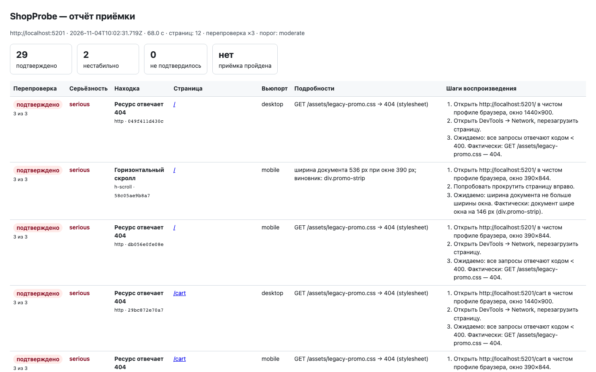
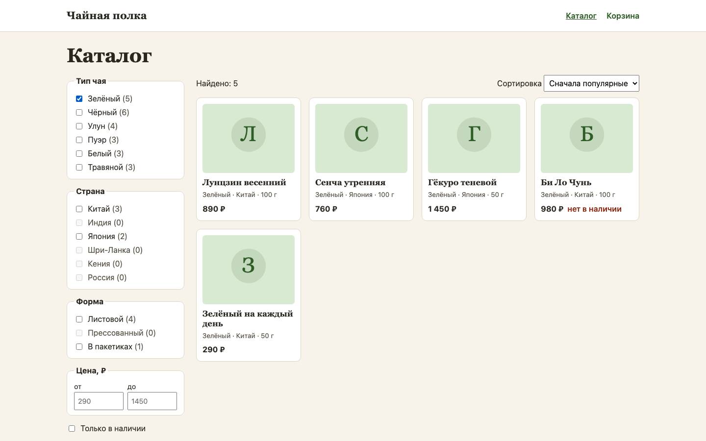
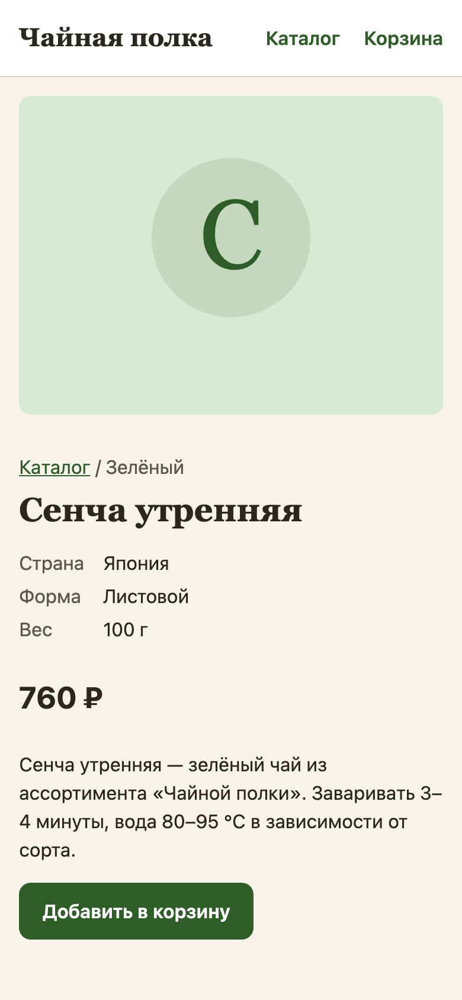

# ShopProbe

Владелец интернет-магазина перед выкаткой проходит сайт с ноутбука и телефона и всё равно
пропускает битую вёрстку и ошибки в консоли. ShopProbe прогоняет Playwright-проверки по страницам
на двух вьюпортах, перепроверяет каждую находку в чистом браузере и подтверждает только повторившееся.

Стенд — вымышленная витрина «Чайная полка» с семью посаженными дефектами ([01-problem](docs/01-problem.md)).



<p>
  
  
</p>

Отчёт — `make probe` по витрине с `SEEDED_BUGS=1`: 29 подтверждено, 2 нестабильно.
Разбор чисел — [05-testing](docs/05-testing.md#прогон-shopprobe).

## Карта модулей

| Модуль | В демо |
|---|---|
| Проверки: консоль, HTTP ≥ 400, битые картинки, скролл, один h1 на 1440×900 и 390×844 | ✅ |
| Доступность: axe-core, WCAG 2.1 AA | ✅ |
| Перепроверка находок | ✅ |
| Отчёт JSON и HTML, код выхода для CI | ✅ |
| Демо-витрина с посаженными дефектами | ✅ |
| Визуальная регрессия | ⬜ |
| Производительность, SEO | ⬜ |
| Сценарии заказа и оплаты | ⬜ |
| Ночной прогон с уведомлениями | ⬜ |
| Агентный разбор отчёта | ⬜ |

## Решения и компромиссы

- **Каждая находка перепроверяется 3 раза в новом контексте браузера.** 3 из 3 — подтверждено,
  0 — нет, между — нестабильно. Ретраи раннера прячут нестабильность, поэтому отказался.
  Цена — прогон по дефектной витрине вчетверо дольше. [ADR-0003](docs/03-design/adr/0003-retest-in-clean-context.md)
- **Витрина — чёрный ящик, только браузер и HTTP.** Плагину в сборку нужен доступ к коду
  каждой витрины. Цена — шум HMR и расширений фильтрую сам. [ADR-0002](docs/03-design/adr/0002-store-as-black-box.md)
- **Свои проверки на Playwright и axe-core.** Lighthouse CI ставит странице оценку, мне нужен
  список находок с шагами. Минус — два рантайма, Python и Node. [ADR-0001](docs/03-design/adr/0001-stack.md)
- **Сбой самой проверки — находка critical.** Иначе упавшая проверка неотличима от чистой страницы.
- **Режим дефектов задаёт окружение API, фронт читает его из `GET /api/meta`.** Одна сборка фронта
  на оба режима; `?bugs=1` отбросил, его включил бы любой посетитель.

## Что не сделано и почему

- `make up` не запускал: Docker на машине нет, compose проверен тестом на порты.
- За авторизацию и оплату ShopProbe не заходит: модуля сценариев нет.
- Дефект реже раза в четыре визита может не попасть в отчёт, это задача мониторинга.

## Запуск

```bash
make up                  # Docker: витрина http://localhost:5201
SEEDED_BUGS=1 make up    # то же с посаженными дефектами
make probe               # прогон, отчёт в probe/reports/latest/
```

Без Docker (Python 3.12 + uv, Node 24, PostgreSQL 16 на `localhost:55201`):

```bash
make install && make dev   # SEEDED_BUGS=1 make dev — с дефектами
```

Проверки: `make lint test e2e`, последний прогон — 131 тест, все зелёные. Другая витрина —
правка `baseUrl` и `routes` в [`probe/probe.config.ts`](probe/probe.config.ts).

## Как это сделано

Код писал Claude Code по моим брифам, вердикты по ревью — мои. Codex ревьюил готовый кейс только
на чтение: 11 находок, все подтвердились, девять — тестом, красным до правки. До ревью первый
`make probe` упал на ошибке, которую Vitest не видел, — теперь прогон CLI входит в критерий готовности.
Ещё один пропуск (BUG-09) нашёл сам, сверив отчёт со скриншотом и мета-тестом. Подробно — [04-ai-development](docs/04-ai-development.md).

## Документация

[Постановка](docs/01-problem.md) · [Процессы](docs/02-analysis/processes.md) ·
[Use case](docs/02-analysis/use-cases.md) · [Требования](docs/02-analysis/requirements.md) ·
[Истории](docs/02-analysis/user-stories.md) · [Архитектура](docs/03-design/architecture.md) ·
[ER](docs/03-design/er.md) · [OpenAPI](docs/03-design/openapi.yaml) · [AI-разработка](docs/04-ai-development.md) ·
[Тесты](docs/05-testing.md) · [Баги](docs/06-bugs.md) · [Релизы](docs/07-releases.md)

Стек: TypeScript, Playwright, axe-core · Python, FastAPI, PostgreSQL · React.
