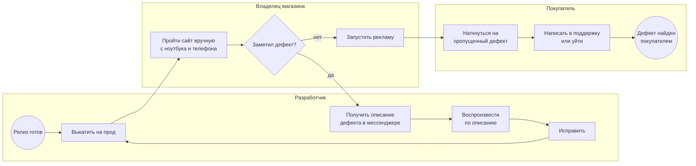
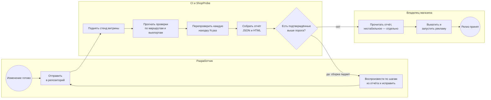
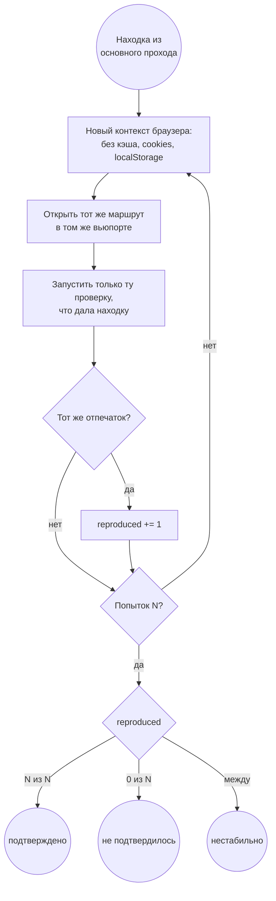

# Процессы приёмки

Те же процессы, что в [as-is.bpmn](as-is.bpmn) и [to-be.bpmn](to-be.bpmn) (BPMN 2.0,
открываются в bpmn.io и Camunda Modeler). Здесь — в Mermaid, чтобы читалось прямо на GitHub.

## Как есть

Приёмку делает владелец руками. Дефект, который он не заметил, находит покупатель.

Узкие места: проход занимает около 40 минут и покрывает 5–6 страниц; «воспроизвести
по описанию» — угадывание, в описании нет ни размера окна, ни точного URL.

## Как будет

Проверки гоняет CI. В «подтверждено» попадает только то, что повторилось во всех
перепроверках. Нестабильное идёт отдельным списком и сборку не валит.

## Перепроверка находки

Подпроцесс «Перепроверить каждую находку N раз» подробнее:

Отпечаток находки — хэш от проверки, маршрута, вьюпорта и того, что сломано
(URL ресурса, правило axe, текст ошибки без номеров строк).
