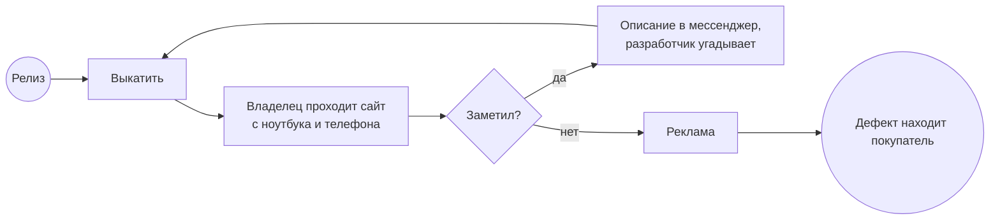
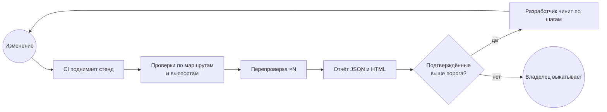

# Процессы приёмки

Mermaid-версия [as-is.bpmn](as-is.bpmn) и [to-be.bpmn](to-be.bpmn).

## Как есть

## Как будет

Что изменилось:

- По сайту ходит CI на каждой сборке, владелец читает отчёт.
- Разработчик получает URL, размер окна и шаги.
- Сборку валят только подтверждённые находки, нестабильные идут отдельно.
