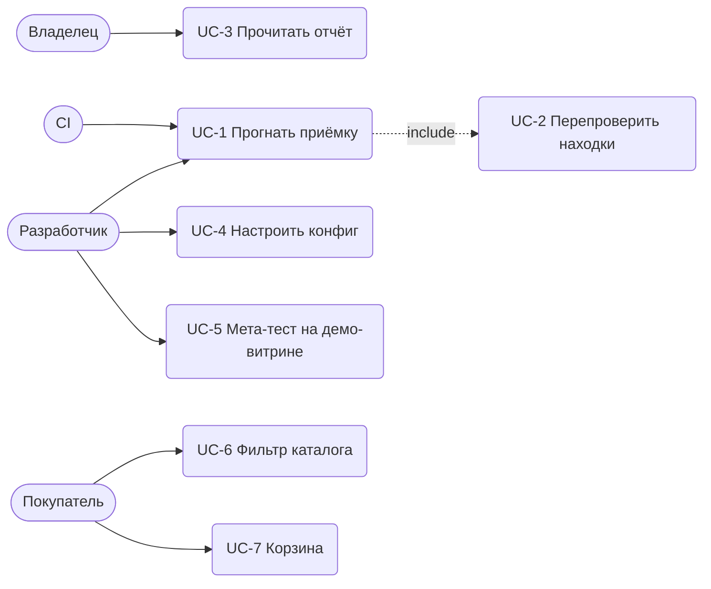

# Варианты использования

## UC-1. Прогнать приёмку витрины

1. Актор запускает `make probe`.
2. ShopProbe открывает каждый маршрут на каждом вьюпорте в новом контексте браузера.
3. Ждёт, пока страница устоится, прокручивает её до конца.
4. Проверяет раскладку, h1, доступность, картинки, консоль, сеть.
5. Перепроверяет находки (UC-2), пишет отчёт, выходит с кодом 0.

Есть подтверждённая находка не ниже `failOn` — код 1. Страница не открылась или упала проверка —
находка critical. Неверный конфиг — код 2.

Остальные: UC-2 — N визитов и вердикт · UC-3 — HTML-отчёт · UC-4 — конфиг · UC-5 — `make e2e`
в двух режимах · UC-6 — фасеты · UC-7 — корзина в localStorage.
