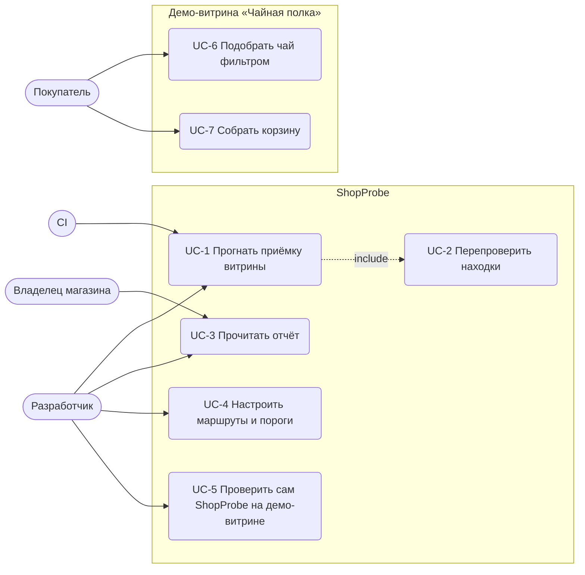

# Варианты использования

## Сценарии

### UC-1. Прогнать приёмку витрины

| | |
|---|---|
| Актор | Разработчик или CI |
| Предусловие | витрина запущена и доступна по BASE_URL; настроен `probe.config.ts` |
| Основной сценарий | 1. Актор запускает `make probe`. 2. ShopProbe открывает каждый маршрут на каждом вьюпорте в новом контексте браузера. 3. Ждёт, пока страница устоится (load, сеть, шрифты). 4. Выполняет проверки: раскладка, h1, axe, картинки, консоль, сеть. 5. Перепроверяет находки (UC-2). 6. Пишет `report.json`, `report.html`, печатает сводку. 7. Завершается с кодом 0. |
| Альтернативный | 7а. Есть подтверждённые находки не ниже порога `failOn` — код выхода 1, CI помечает сборку красной. |
| Исключения | 2а. Страница не открылась (таймаут, обрыв) — находка «Страница не открылась», critical. 4а. Сама проверка упала — находка «Проверка не выполнилась», critical: прогон не «зеленеет» молча. 1а. Неверный конфиг (пустой список маршрутов, маршрут без «/», N вне 1…10) — код выхода 2 и текст ошибки. |

### UC-2. Перепроверить находки

| | |
|---|---|
| Актор | ShopProbe (включается из UC-1) |
| Основной сценарий | 1. Находки группируются по паре «маршрут × вьюпорт». 2. Для каждой пары N раз: новый контекст, тот же маршрут, только нужные проверки. 3. Для каждой находки считается число воспроизведений. 4. Вердикт: N из N — подтверждено, 0 — не подтвердилось, иначе — нестабильно. |
| Альтернативный | 2а. N = 1 в конфиге — перепроверка один раз (быстрый локальный прогон). |
| Исключения | 2б. Перепроверочный визит не открыл страницу — находка не воспроизведена в этой попытке. |

### UC-3. Прочитать отчёт

| | |
|---|---|
| Актор | Владелец, разработчик |
| Основной сценарий | 1. Открыть `report.html`. 2. Сверху — карточки: подтверждено, нестабильно, не подтвердилось, пройдена ли приёмка. 3. Таблица отсортирована: подтверждённые и серьёзные первыми. 4. В строке — страница, вьюпорт, подробности, шаги воспроизведения. |
| Альтернативный | 1а. Машинный разбор — `report.json` (тот же состав полей). |

### UC-4. Настроить маршруты и пороги

| | |
|---|---|
| Актор | Разработчик |
| Основной сценарий | 1. Правит `probe.config.ts`: BASE_URL, routes, viewports, retest, thresholds, a11y. 2. Запускает UC-1. |
| Альтернативный | 1а. Флаги командной строки (`--base-url`, `--routes`, `--retest`, `--out`) перекрывают файл. 1б. Добавляет свои шаблоны в `console.ignore` — они дополняют встроенные. |

### UC-5. Проверить сам ShopProbe

| | |
|---|---|
| Актор | Разработчик ShopProbe |
| Основной сценарий | 1. `make e2e`. 2. Поднимается чистая витрина: мета-тест требует ноль подтверждённых. 3. Витрина перезапускается с `SEEDED_BUGS=1`: мета-тест требует найти каждый из посаженных дефектов, а нестабильный запрос — не подтвердить. |
| Исключения | 2а. На чистой витрине есть подтверждённая находка — это ложное срабатывание или реальный дефект витрины; тест падает с полной сводкой. |

### UC-6. Подобрать чай фильтром

| | |
|---|---|
| Актор | Покупатель |
| Основной сценарий | 1. Открывает каталог. 2. Отмечает тип, страну, форму, цену, «только в наличии». 3. Видит число найденных и счётчики у каждого значения. 4. Состояние сохраняется в URL. |
| Альтернативный | 2а. Сортирует по цене или названию. 3а. Под фильтры ничего нет — подсказка снять часть условий. |
| Исключения | 2б. В URL мусор (`price_min=abc`) — фронт игнорирует значение, API на прямой запрос отвечает 422. |

### UC-7. Собрать корзину

| | |
|---|---|
| Актор | Покупатель |
| Основной сценарий | 1. На карточке нажимает «Добавить в корзину». 2. Счётчик в шапке растёт. 3. В корзине меняет количество, удаляет позиции, видит итог. |
| Альтернативный | 3а. Перезагрузка страницы — корзина на месте (localStorage). |
| Исключения | 3б. В localStorage мусор или хранилище недоступно — корзина пустая, витрина не падает. Оформление и оплата в демо не входят. |
