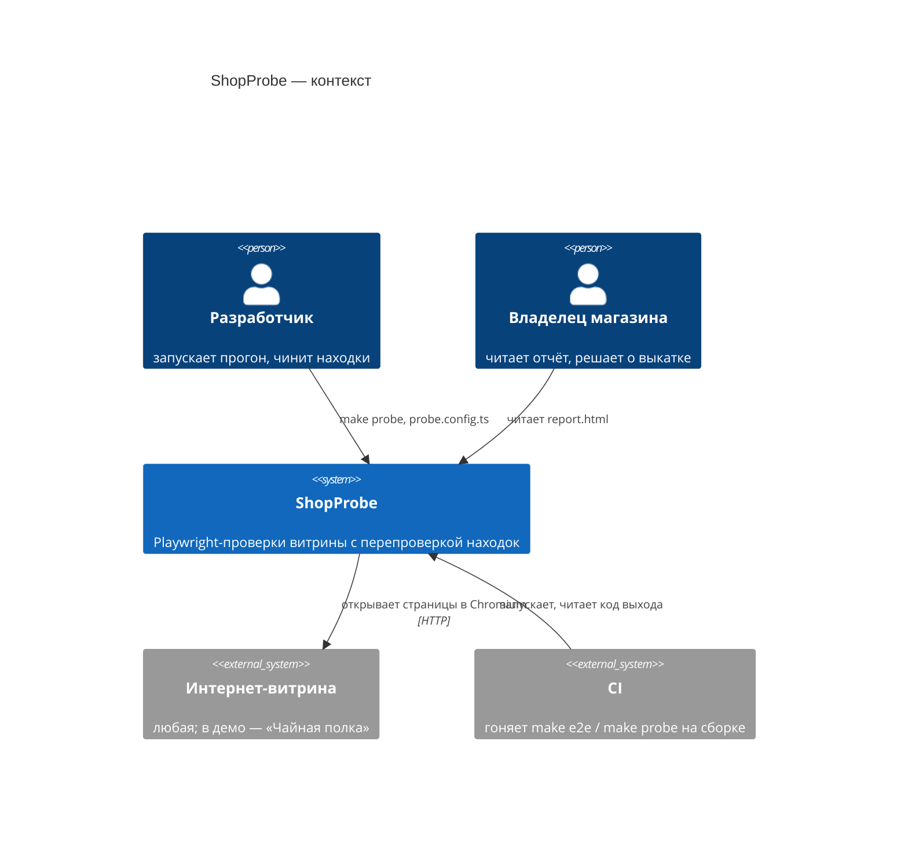
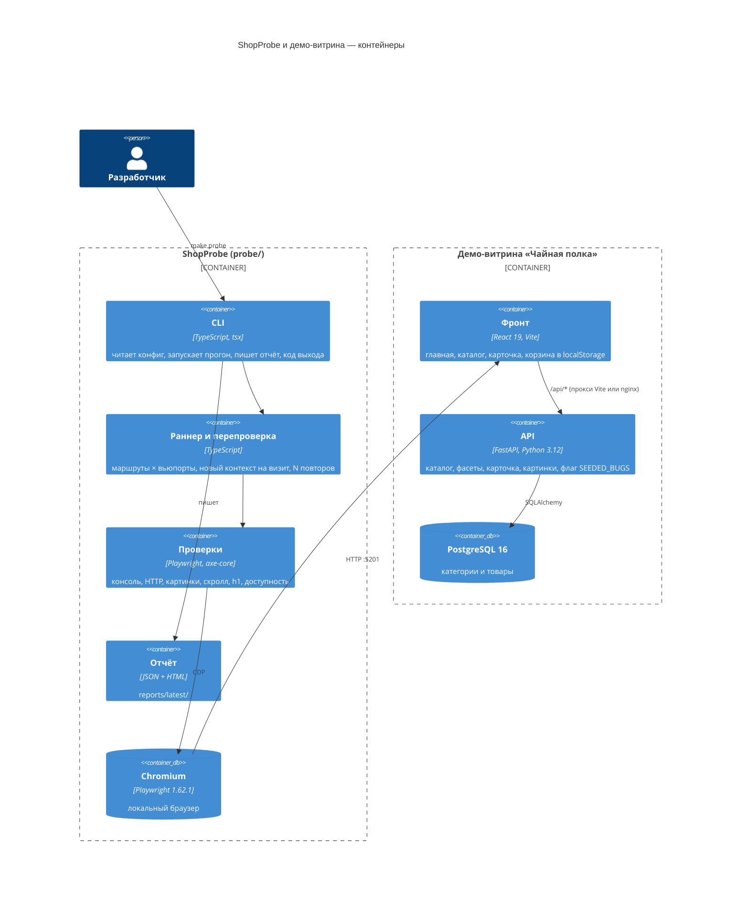
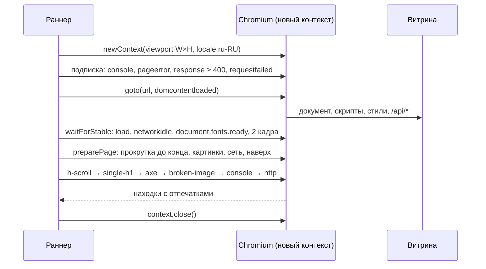

# Архитектура

## C4: контекст

ShopProbe смотрит на витрину как покупатель: только через браузер и HTTP, без доступа
к её коду и базе ([ADR-0002](adr/0002-store-as-black-box.md)).

## C4: контейнеры

## Как устроен визит страницы

Прокрутка идёт до всех проверок: раскладка, h1 и axe видят то, что страница подгружает
при прокрутке (BUG-07). Консоль и сеть — последними: в них попадает всё, что случилось за визит.

## Модули probe/

| Файл | Ответственность |
|---|---|
| `src/config.ts` | `defineConfig`, значения по умолчанию, слияние с флагами CLI, валидация |
| `src/inspect.ts` | один визит: контекст, подписки на события, ожидание, подготовка, проверки, сбой проверки → находка |
| `src/run.ts` | основной проход, перепроверка, сводка, код выхода |
| `src/checks/*.ts` | по файлу на проверку; общий контракт `Check = (ctx) => Promise<Finding[]>` |
| `src/finding.ts` | отпечаток, шаги воспроизведения, вердикт, нормализация текста консоли |
| `src/report/*.ts` | HTML с экранированием, JSON, консольная сводка |
| `src/cli.ts` | разбор аргументов, загрузка `probe.config.ts`, коды выхода 0/1/2 |

Новая проверка = новый файл в `checks/` и строка в `checks/index.ts`. Раннер и отчёт
о ней ничего не знают.

## Посаженные дефекты

Флаг `SEEDED_BUGS` читает только бэкенд. Фронт узнаёт его из `GET /api/meta`, поэтому
одна сборка фронта обслуживает оба режима, и мета-тест переключает режим перезапуском
API ([ADR-0004](adr/0004-seeded-bugs-runtime-flag.md)).

| Дефект | Где живёт | Как устроен |
|---|---|---|
| Битая картинка | API | `/api/images/shu-puer-staroe-derevo.svg` отдаёт 200 и обрезанный SVG |
| Нестабильный запрос | API | `/api/recommendations` отвечает 503 на каждый нечётный вызов |
| Ошибка в консоли | фронт | виджет отзывов на карточке пишет `console.error` |
| 404 статического ресурса | фронт | `<link rel="stylesheet" href="/assets/legacy-promo.css">` на всех страницах |
| Горизонтальный скролл на 390 px | фронт | промо-полоса шириной 520 px на главной |
| Два h1 | фронт | второй h1 «Скидки недели» в каталоге |
| Низкий контраст | фронт | кнопка «Добавить в корзину» #a3aba0 на #e3e8e1 |
