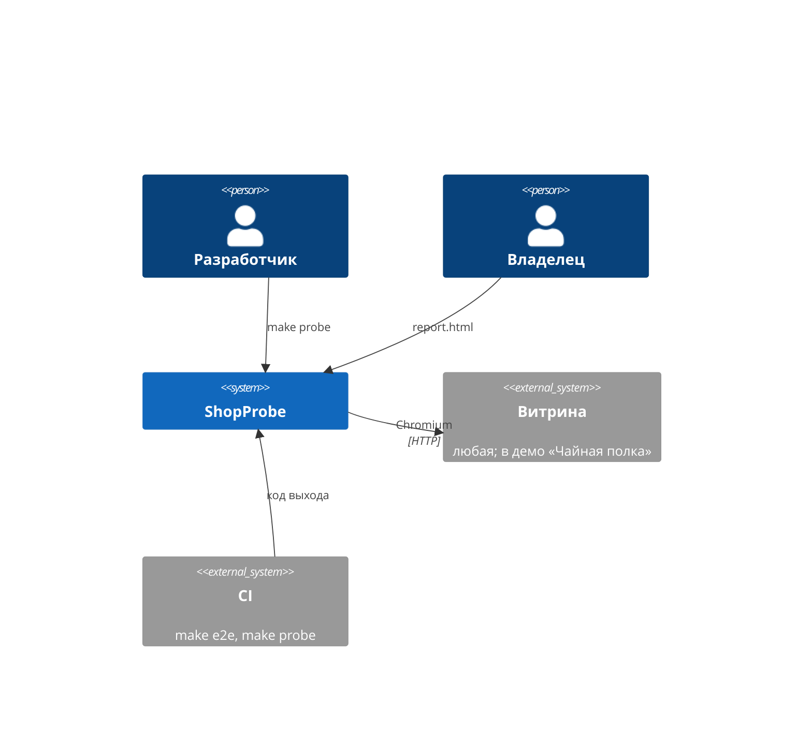
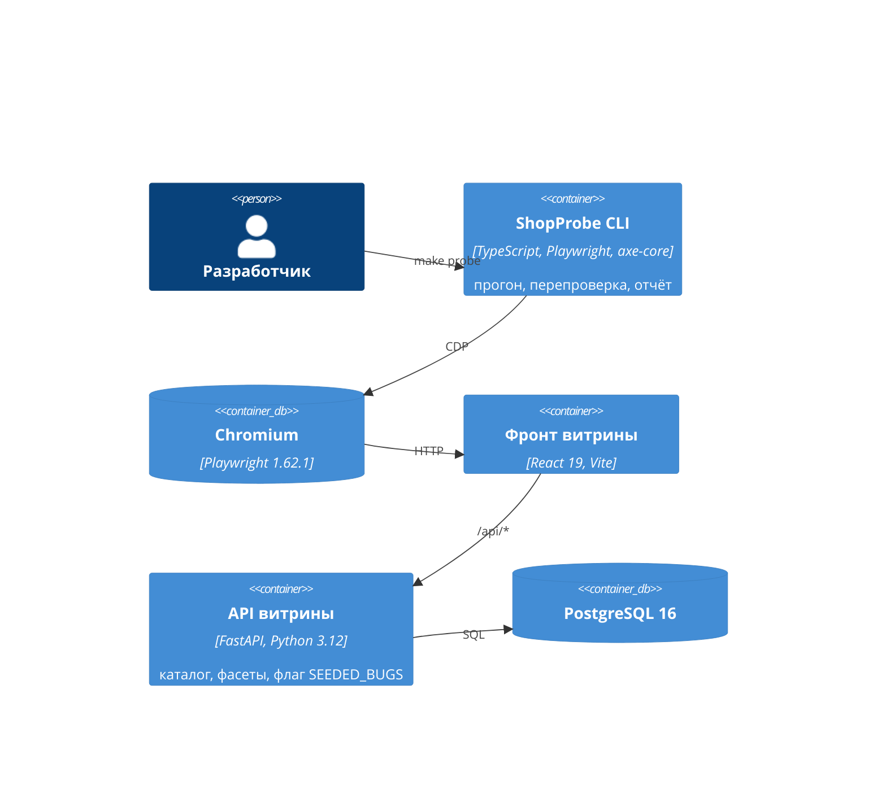

# Архитектура

## C4: контекст

ShopProbe видит витрину как покупатель: браузер и HTTP, без доступа к коду и базе
([ADR-0002](adr/0002-store-as-black-box.md)).

## C4: контейнеры

Стек — [ADR-0001](adr/0001-stack.md).
