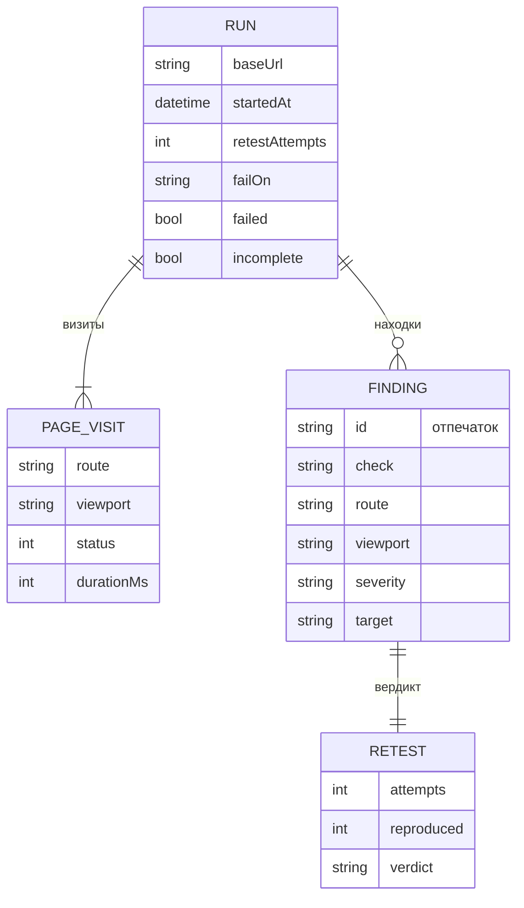
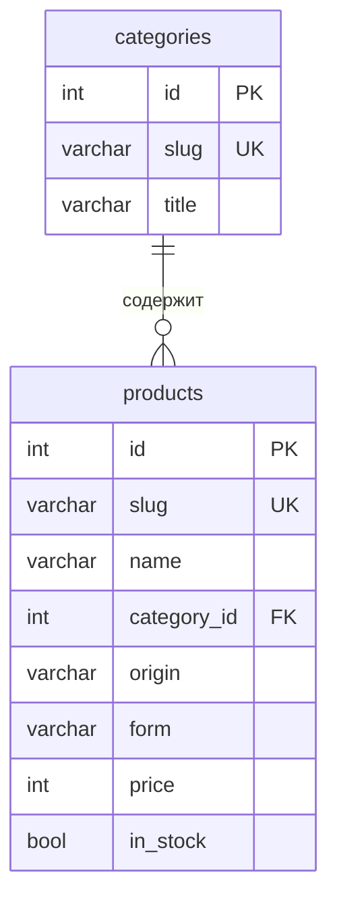

# Модель данных

Две модели: данные самого ShopProbe (живут в `report.json`, базы нет) и база демо-витрины.

## ShopProbe: прогон и находки

| Сущность | Что это | В коде |
|---|---|---|
| Прогон | один запуск по всем маршрутам и вьюпортам, итог и порог | `Report`, `Summary` |
| Визит | маршрут × вьюпорт, HTTP-статус и время | `PageVisit` |
| Находка | дефект с шагами воспроизведения | `Finding` |
| Отпечаток | `Finding.id`: тип проверки, маршрут, вьюпорт и цель; та же проблема в повторе даёт тот же id | `probe/src/finding.ts` |
| Вердикт | сколько повторов из N воспроизвели отпечаток: `confirmed`, `flaky`, `not_reproduced` | `Retest` |

Схема — `probe/src/types.ts`.

## Демо-витрина

| Сущность | Что это |
|---|---|
| `categories` | тип чая, slug идёт в URL фильтра |
| `products` | товар, slug — адрес карточки, цена в рублях |
| `origin`, `form` | коды страны и формы со справочником в коде: значений шесть и три, таблицы не нужны |

Фасетный счётчик группы считается отдельным `GROUP BY` со всеми фильтрами, кроме фильтра
этой группы ([BUG-03](../06-bugs.md)).
