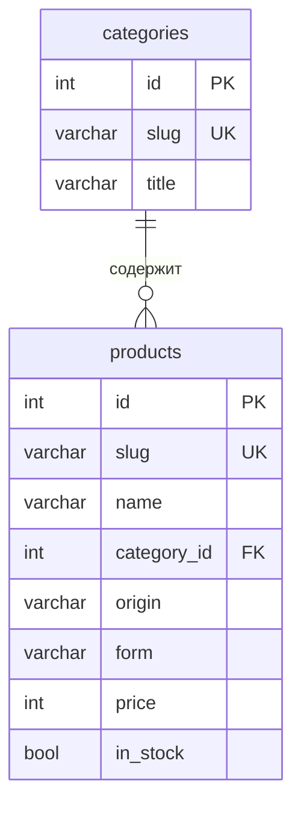

# Модель данных демо-витрины

У ShopProbe базы нет, только файлы отчёта.

| Сущность | Что это |
|---|---|
| `categories` | тип чая, slug идёт в URL фильтра |
| `products` | товар, slug — адрес карточки, цена в рублях |
| `origin`, `form` | коды страны и формы со справочником в коде: значений шесть и три, таблицы не нужны |

Фасетный счётчик группы считается отдельным `GROUP BY` со всеми фильтрами, кроме фильтра
этой группы ([BUG-03](../06-bugs.md)).
