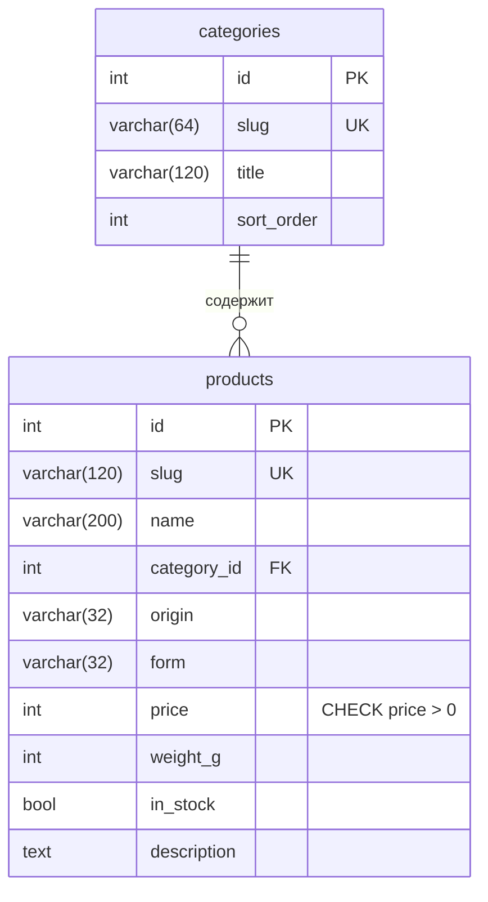

# Модель данных демо-витрины

ShopProbe своей базы не имеет: результат прогона — файлы `report.json` и `report.html`.
База ниже — у демо-витрины.



## Словарь

| Таблица.поле | Тип | Смысл |
|---|---|---|
| `categories.slug` | varchar(64), уникальный | код типа чая в URL: `green`, `black`, `oolong`, `puer`, `white`, `herbal` |
| `categories.title` | varchar(120) | подпись на витрине: «Зелёный» и т. д. |
| `categories.sort_order` | int | порядок в фильтре и на главной |
| `products.slug` | varchar(120), уникальный | адрес карточки `/product/{slug}` и имя картинки |
| `products.category_id` | FK → categories.id, индекс | тип чая |
| `products.origin` | varchar(32), индекс | код страны: `china`, `india`, `japan`, `srilanka`, `kenya`, `russia`. Подписи — в `app/dictionaries.py` |
| `products.form` | varchar(32), индекс | `leaf` — листовой, `pressed` — прессованный, `bags` — в пакетиках |
| `products.price` | int, > 0 | цена упаковки в рублях, без копеек |
| `products.weight_g` | int | вес упаковки, г |
| `products.in_stock` | bool | есть ли в наличии; фильтр «Только в наличии» |
| `products.description` | text | текст карточки |

Страна и форма — строковые коды со справочником в коде, а не отдельные таблицы:
значений шесть и три, они не меняются без выкатки, а фасетный запрос остаётся
одним `GROUP BY` без лишних соединений.

## Схема фасетного запроса

Для каждой группы (тип, страна, форма) — отдельный запрос со всеми фильтрами,
кроме фильтра этой группы:

```sql
SELECT p.origin, count(p.id)
FROM products p JOIN categories c ON c.id = p.category_id
WHERE c.slug IN ('green')            -- фильтр типа применён
  AND p.in_stock IS true             -- общие фильтры применены
  -- фильтр по origin НЕ применён: группа считает сама себя без своего выбора
GROUP BY p.origin;
```

Почему так — [BUG-03](../06-bugs.md#bug-03-счётчик-фасета-сжимался-до-одного-значения).
Миграции — Alembic, `backend/alembic/versions/0001_catalog.py`.
