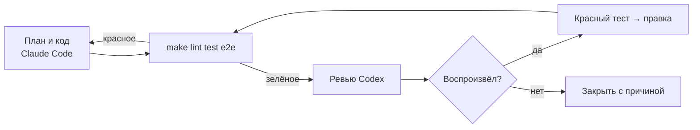

# 04. Разработка с AI-агентами

Код писал Claude Code, ревьюил готовый кейс Codex (gpt-6.1-sol, effort high, только чтение).
Моё — постановка, разрез на задачи, критерии готовности и вердикт по каждой находке.

## Конвейер

«Тесты проходят» в отчёте агента проверяю запуском у себя. Находка ревью подтверждена, когда
есть тест, красный на текущем коде. План другой моделью до кода не проверял, и это видно:
три находки из одиннадцати — про перепроверку, на плане их поймать было бы дешевле.

## Разрез на задачи

| # | Задача | Кто | Готово, когда |
|---|---|---|---|
| 1 | Постановка, требования, истории | я | у каждого FR есть проверка |
| 2 | БД и API каталога | Claude Code | интеграционные тесты зелёные |
| 3 | Фронт витрины | Claude Code | Vitest и e2e на двух вьюпортах |
| 4 | Ядро ShopProbe | Claude Code | тесты на фикстурах, позже и прогон CLI |
| 5 | Перепроверка и вердикты | Claude Code | фикстура «через раз» → нестабильно |
| 6 | Посаженные дефекты, мета-тест | Claude Code | чистая 0, дефектная — все найдены |
| 7 | Ревью | Codex | находки с серьёзностью |
| 8 | Разбор ревью | Claude Code, вердикт — я | тест, красный до правки |

## Ревью Codex: 11 находок, все подтвердились

Тест краснел до правки у всех, кроме R1 (Docker нет, подтвердил чтением файла) и R11 (пробел
в тесте: новый тест краснеет при сдвиге OFFSET на единицу).

| # | Находка | Вердикт | Тест |
|---|---|---|---|
| R1 | P1: PostgreSQL в compose открыт наружу с паролем `postgres` | подтверждена чтением; порты на `127.0.0.1` | `backend/tests/unit/test_compose.py` |
| R2 | P1: витрина упала после первого визита — приёмка зелёная | подтверждена, BUG-06 | `probe/tests/browser/review.test.ts` → R2 |
| R3 | P1: ошибка от прокрутки при перепроверке давала 0 из 3 | подтверждена, BUG-07 | `review.test.ts` → R3 |
| R4 | P2: 500 и 503 давали разные отпечатки, эндпоинт не подтверждался | подтверждена; отпечаток по классу ответа | `review.test.ts` → R4 |
| R5 | P2: имя вьюпорта не проверялось на уникальность | подтверждена; повтор — ошибка конфига | `tests/unit/review.test.ts` → R5 |
| R6 | P2: опечатка в `failOn` или `minImpact` тихо выключала падение приёмки | подтверждена; значения проверяются | `tests/unit/review.test.ts` → R6 |
| R7 | P2: нарушение axe на другом элементе «подтверждало» старое | подтверждена; в отпечатке узлы | `review.test.ts` → R7 |
| R8 | P2: раскладка, h1 и axe шли до прокрутки | подтверждена, BUG-07 | `review.test.ts` → R8 |
| R9 | P2: запрет localStorage ронял витрину | подтверждена, BUG-08 | `frontend/src/lib/context.test.tsx` |
| R10 | P2: шаблон игнора с флагом `g` срабатывал через раз | подтверждена; сброс `lastIndex` | `tests/unit/review.test.ts` → R10 |
| R11 | P2: тест пагинации не ловил пересечение страниц | подтверждена как пробел в тесте | `test_catalog_api.py::test_sort_and_pagination` |

Пути `tests/unit` и `review.test.ts` — внутри `probe/`.

## Что AI пропустил до ревью

Браузерные тесты под Vitest были зелёными, а первый `make probe` дал двенадцать находок
`ReferenceError: __name is not defined`. esbuild в tsx оборачивает именованные функции в `__name(...)`,
а функция для `page.evaluate` уходит в страницу, где помощника нет. Vitest собирает код иначе.

Функции переписали, добавили `probe/tests/browser/cli.test.ts` — CLI через `npx tsx`, как у пользователя.
Каждая проверка получила свой `try`, сбой проверки стал находкой. Критерий задачи 4 не проверял способ запуска.
