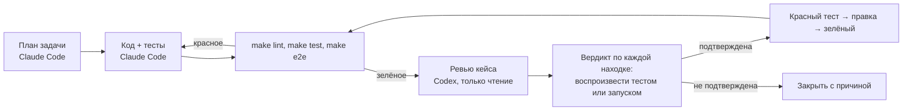

# 04. Разработка с AI-агентами

Код кейса писал Claude Code. Ревьюил Codex (gpt-6.1-sol, effort high, только чтение):
он получил готовый репозиторий кейса и ничего не менял. Моя часть — постановка,
разрез на задачи, критерии готовности, разбор находок ревью и решение, что считать сделанным.

## Как задача разрезалась

Правило разреза: у каждой задачи есть вход, который агент может прочитать целиком,
и критерий готовности, который проверяется командой, а не словами «вроде работает».

| # | Задача | Исполнитель | Вход | Критерий готовности |
|---|---|---|---|---|
| 1 | Постановка, требования FR/NFR, истории | я | бриф кейса | у каждого FR есть способ проверки |
| 2 | Модель данных, миграция, наполнение каталога | Claude Code | `docs/03-design/er.md` | `alembic upgrade head` на пустой базе, 24 товара |
| 3 | API каталога с фасетами | Claude Code | FR-01…FR-04 | интеграционные тесты на PostgreSQL зелёные |
| 4 | Фронт витрины: каталог, карточка, корзина | Claude Code | API, US-01…US-04 | Vitest + e2e на двух вьюпортах |
| 5 | Ядро ShopProbe: визит, проверки, отчёт | Claude Code | FR-06…FR-10 | браузерные тесты на фикстурах |
| 6 | Перепроверка и вердикты | Claude Code | ADR-0003 | фикстура «через раз» → нестабильно |
| 7 | Посаженные дефекты и мета-тест | Claude Code | FR-12, список дефектов | чистая витрина — 0, с дефектами — все найдены |
| 8 | Прогон по витрине, разбор находок | Claude Code, решение — я | `make probe`, отчёт | каждая находка — дефект витрины или баг инструмента, с тестом |
| 9 | Ревью всего кейса | Codex | репозиторий кейса, только чтение | список находок с серьёзностью и способом проверки |
| 10 | Разбор ревью: вердикт по каждой находке, правки | Claude Code, решение — я | отчёт Codex | у каждой подтверждённой — тест, который был красным до правки |
| 11 | Документация 01–07 | Claude Code, правка — я | код, отчёты прогонов | цифры — только из прогонов этого репозитория |

## Конвейер, как он прошёл в этом кейсе

Независимой проверки плана другой моделью до кода в этом кейсе не было: Codex смотрел
готовый код. По итогам ревью это видно — три из одиннадцати находок касаются перепроверки,
то есть решения из ADR-0003, и их дешевле было бы поймать на плане.

Правила, которые я держал:

- **Пустой ответ ревьюера — не одобрение.** Одобрение — это ответ, в котором видно,
  что код прочитан: файл, строка, способ воспроизвести.
- **Находка ревью — не факт.** Каждую я воспроизводил сам: сначала тест, который
  краснеет на текущем коде, потом правка. Красный тест до правки — критерий того,
  что находка подтверждена.
- **Отчёт агента — не факт.** «Тесты проходят» проверяется запуском `make test` у меня.

## Ревью Codex gpt-6.1-sol

Одиннадцать находок, все подтвердились. Тесты в столбце «Тест» были красными до правки,
кроме R1 (Docker на машине нет, подтверждено чтением файла и тестом на конфиг) и R11
(это пробел в тесте: проверил, что новый тест краснеет при сдвиге OFFSET на единицу).

| # | Находка | Серьёзность | Вердикт | Что сделали | Тест |
|---|---|---|---|---|---|
| R1 | PostgreSQL в `docker-compose.yml` опубликован на всех интерфейсах с паролем `postgres` | P1 | подтверждена чтением, Docker не запускал | все порты стенда — только `127.0.0.1:`, пароль из `POSTGRES_PASSWORD` | `backend/tests/unit/test_compose.py` |
| R2 | Сбой навигации при перепроверке терялся: витрина упала после первого визита — исходная находка «не подтвердилась», приёмка зелёная | P1 | подтверждена | сбой навигации или проверки, появившийся при перепроверке, идёт в отчёт со своим вердиктом | `probe/tests/browser/review.test.ts` → R2 |
| R3 | Перепроверка запускала только проверки, давшие находку; прокрутка жила в проверке картинок — ошибка консоли, вызванная прокруткой, давала 0 из 3 | P1 | подтверждена | перепроверка гоняет все проверки; прокрутка вынесена в подготовку визита | `review.test.ts` → R3 |
| R4 | Отпечаток HTTP включал точный код и query: 500 → 503 — разные находки, сломанный эндпоинт «не подтверждался» | P2 | подтверждена | отпечаток — метод, путь без query, класс ответа (`5xx`); точный код — в подробностях | `review.test.ts` → R4, `tests/unit/review.test.ts` |
| R5 | Вьюпорт для перепроверки ищется по имени, уникальность не проверялась | P2 | подтверждена | повтор имени — ошибка конфига | `tests/unit/review.test.ts` → R5 |
| R6 | `failOn` и `minImpact` не проверялись в рантайме: опечатка тихо выключала падение приёмки | P2 | подтверждена | проверка значений по шкале серьёзности | `tests/unit/review.test.ts` → R6 |
| R7 | Отпечаток axe — только правило: нарушение на другом элементе «подтверждало» исходную находку со старыми шагами | P2 | подтверждена | в отпечатке правило и селекторы узлов | `review.test.ts` → R7 |
| R8 | Раскладка, h1 и axe проверялись до прокрутки: содержимое, подгружаемое при прокрутке, не проверялось | P2 | подтверждена | подготовка визита прокручивает страницу до конца до всех проверок | `review.test.ts` → R8 |
| R9 | Чтение `window.localStorage` вне `try`: запрет хранилища ронял витрину целиком | P2 | подтверждена | доступ к хранилищу через `browserStorage()` с `try`; без хранилища корзина живёт в памяти | `frontend/src/lib/context.test.tsx` |
| R10 | `RegExp.test()` с флагами `g`/`y` сдвигает `lastIndex`: одинаковые игнорируемые сообщения проходили фильтр через раз | P2 | подтверждена | сброс `lastIndex` перед проверкой | `tests/unit/review.test.ts` → R10 |
| R11 | Тест пагинации не ловил пересечение страниц | P2 | подтверждена (пробел в тесте) | тест проверяет, что страницы не пересекаются и вместе дают весь каталог | `backend/tests/integration/test_catalog_api.py::test_sort_and_pagination` |

Значимые из них — R2, R3, R8, R9 — разобраны в [06-bugs](06-bugs.md) как BUG-06…BUG-08.

## Что нашёл сам Claude Code до ревью

Все браузерные тесты под Vitest были зелёными, а первый же `make probe` по витрине
вернул двенадцать находок «Страница не открылась: `ReferenceError: __name is not defined`».
CLI запускается через tsx, а esbuild в tsx включает `keepNames` и оборачивает
`const f = () => …` в `__name(f, "f")`. Функция, переданная в `page.evaluate`,
сериализуется в страницу — помощника `__name` там нет. Vitest собирает код иначе,
поэтому тесты этого не видели.

Что сделали:

1. Функции для `page.evaluate` переписаны без именованных вложенных функций; правило
   записано комментарием в `src/page.ts`.
2. Добавлен `probe/tests/browser/cli.test.ts`: CLI запускается как у пользователя,
   через `npx tsx`, по фикстурам. Тест краснеет, если вернуть `const pause = () => …`
   в `scrollThrough`.
3. Навигация и каждая проверка получили свой `try`: при общей `try/catch` такой сбой
   маскировался под «страница не открылась» и при перепроверке не подтверждался.
   Сбой проверки теперь — находка той же проверки с целью `probe-error`, critical.

Вывод: критерий готовности задачи 5 был неполным — «тесты на фикстурах» проверяли
проверки, но не способ запуска. Теперь в критерий входит прогон CLI.
