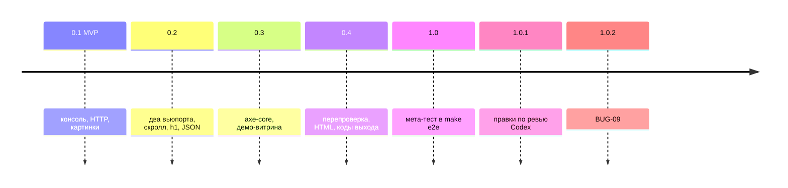

# 07. Путь к релизу

Версии ShopProbe и витрины идут вместе, изменения — в [CHANGELOG.md](CHANGELOG.md).

Каждую часть проверял предыдущей: перепроверка ждала витрины с нестабильным запросом.

Дальше по пользе для владельца: ночной прогон, сценарии заказа, визуальная регрессия.
