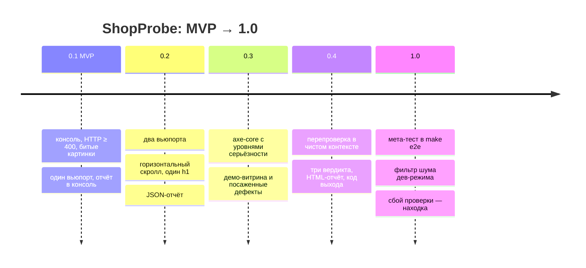

# 07. Путь к релизу

Версии ShopProbe и демо-витрины идут вместе: витрина существует, чтобы проверять инструмент.
Подробный список изменений — [CHANGELOG.md](CHANGELOG.md).

## Что входило и что отложили

| Версия | Вошло | Отложили | Почему отложили |
|---|---|---|---|
| 0.1 MVP | Визит страницы в новом контексте; проверки консоли, HTTP, битых картинок; сводка в консоль | вьюпорты, отчёт-файл | сначала убедиться, что находки вообще воспроизводятся руками |
| 0.2 | Вьюпорты 1440×900 и 390×844; горизонтальный скролл; ровно один h1; `report.json` | доступность | нужен был стенд, на котором видно, что axe находит, а что — нет |
| 0.3 | axe-core (WCAG 2.0/2.1 A, AA), `minImpact`; демо-витрина «Чайная полка»: каталог, фасеты, карточка, корзина; `SEEDED_BUGS` | перепроверка | без стенда с нестабильным запросом её нечем проверить |
| 0.4 | Перепроверка N раз, вердикты, HTML-отчёт с шагами, `failOn` и коды выхода 0/1/2 | мета-тест в CI | сначала руками сверить, что вердикты совпадают с ожиданием |
| 1.0 | Мета-тест в `make e2e` (чистый и `SEEDED_BUGS=1`); BUG-01…BUG-05 закрыты; сбой проверки — находка critical; CLI-тест под tsx | см. ниже | — |

## После 1.0 (в демо не входит)

Модули из карты в [README](../README.md), помеченные ⬜. Порядок — по пользе для владельца:

1. **Ночной прогон с уведомлениями.** Тот же CLI по расписанию; код выхода и `report.json`
   уже есть, не хватает адаптера уведомлений.
2. **Сквозные сценарии заказа.** Нужен модуль сценариев поверх визита: шаги, ожидания,
   тестовые платёжные данные провайдера.
3. **Визуальная регрессия.** Скриншоты на тех же вьюпортах; перепроверка уже умеет
   отличать нестабильное от стабильного — для скриншотов это особенно важно.
4. **Производительность, SEO.** Отдельные проверки по тому же контракту `Check`.
5. **Агентный режим.** Claude Code через Playwright MCP читает `report.json`, открывает
   подтверждённые находки в браузере и готовит баг-репорты. Направление, без кода в демо.
